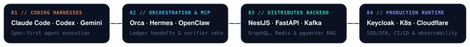

<div align="center">

<picture>
  <source media="(prefers-color-scheme: dark)" srcset="assets/hero-dark.svg" />
  <source media="(prefers-color-scheme: light)" srcset="assets/hero-light.svg" />
  
</picture>

<br/>

<p>
  <a href="https://untern.ai"><kbd> ↗ Untern AI (untern.ai) </kbd></a>&nbsp;
  <a href="https://github.com/UnternAI"><kbd> ⌘ github.com/UnternAI </kbd></a>&nbsp;
  <a href="https://haunguyendev.xyz"><kbd> ✦ haunguyendev.xyz </kbd></a>&nbsp;
  <a href="https://www.linkedin.com/in/haunguyendev/"><kbd> in LinkedIn </kbd></a>&nbsp;
  <a href="mailto:haunt150603@gmail.com"><kbd> ✉ Contact </kbd></a>
</p>

</div>

I'm **Trung Hau Nguyen** (**Nguyễn Trung Hậu**, also known as **Kane Nguyen**), **Co-founder at [Untern AI](https://untern.ai)** ([github.com/UnternAI](https://github.com/UnternAI)) — an applied AI engineering studio in Ho Chi Minh City building production AI systems that read documents, answer from enterprise knowledge, and act reliably inside real operations.

---

### `// 01` · Control Plane & Studio

<table>
<tr>
<td width="52%" valign="top">

#### `kane.manifest.yaml`

```yaml
founder: Trung Hau Nguyen (Kane Nguyen)
role: Co-founder @ Untern AI
location: Ho Chi Minh City, Vietnam

ai_harnesses:
  coding_agents: [Claude Code, Codex, Gemini]
  orchestrators: [Orca, Hermes, OpenClaw]
  tooling_layer: [MCP Servers, Agent Skills, RAG]

production_backbone:
  services: [NestJS, FastAPI, GraphQL]
  streaming: [Apache Kafka, Redis, Socket.IO]
  storage: [PostgreSQL, pgvector]
  security_ops: [Keycloak SSO/2FA, Docker, K8s]

principle: "Agents propose. Verifiers gate. Systems stay up."
```

</td>
<td width="48%" valign="top">

#### Building at [Untern AI](https://untern.ai)

We take applied AI from **fixed-scope Proof Sprint to production**, alongside our core product suite *(in development)*:

- **🟢 Untern Lens** — *Document AI*  
  Turns complex Vietnamese & Japanese paperwork (handwritten forms, mixed-language slips, non-standard layouts) into validated, structured data.

- **🔵 Untern Atlas** — *Knowledge Assistant*  
  Answers internal team questions directly from company policies, procedures, and technical docs — with verifiable citations.

- **🟠 Untern Relay** — *Support Agent*  
  Handles customer conversations across web chat and email with structured human handoff when needed.

<sub>Org: <a href="https://github.com/UnternAI">github.com/UnternAI</a> · Site: <a href="https://untern.ai">untern.ai</a></sub>

</td>
</tr>
</table>

### `// 02` · How I Ship Production AI

<div align="center">
<picture>
  <source media="(prefers-color-scheme: dark)" srcset="assets/pipeline-dark.svg" />
  <source media="(prefers-color-scheme: light)" srcset="assets/pipeline-light.svg" />
  
</picture>
</div>

### `// 03` · Open-Source Agent Lab

<table>
<tr>
<td width="50%" valign="top">

**[`openproject-mcp`](https://github.com/haunguyendev/openproject-mcp)** · `MCP SERVER` `PYTHON`  
Model Context Protocol server connecting Claude and AI coding agents to self-hosted OpenProject instances via REST API v3 for natural-language project & work-package ops.

</td>
<td width="50%" valign="top">

**[`agent-team-setup`](https://github.com/haunguyendev/agent-team-setup)** · `MULTI-AGENT LEDGER`  
Ledger-based multi-agent coordination harness featuring immutable handoffs, independent verifier veto, and coordinator-owned promotion.

</td>
</tr>
<tr>
<td width="50%" valign="top">

**[`ai-agency-os`](https://github.com/haunguyendev/ai-agency-os)** · `DELIVERY HARNESS`  
Operating framework for running AI agents like a managed engineering organization — role clarity, explicit control gates, and release discipline.

</td>
<td width="50%" valign="top">

**[`feynman-skill`](https://github.com/haunguyendev/feynman-skill)** & **[`humanizer-vi`](https://github.com/haunguyendev/humanizer-vi)** · `AGENT SKILLS`  
7-mode Feynman-Technique verification skill for coding agents, plus a Vietnamese editorial & Decree 30/2020 writing adaptation.

</td>
</tr>
</table>

### `// 04` · Stack & Tooling Matrix

**AI Models, Harnesses & Orchestration**  


**Languages, Backend & Distributed Infrastructure**  


<details>
<summary><b>📂 Prior Production Engineering Track Record</b> <sub>(before Untern AI — click to expand)</sub></summary>

<br/>

- **AI Fintech & Trading Platform Architecture** — Built dual-backend systems combining `NestJS` (GraphQL, auth, portfolio, real-time notifications) and `FastAPI` (ML inference, market data & sentiment pipelines) across 20+ API modules, backed by `Kafka`, `Redis`, `Keycloak` SSO/2FA, and `Kubernetes`.
- **Enterprise Multi-Channel AI Platforms** — Shipped 9+ production applications end-to-end across omnichannel AI chatbot platforms (Web, Zalo, Messenger, Teams), fintech, and IoT smart-operations systems.
- **Education** — B.S. in Software Engineering, **FPT University** (*Distinguished & Excellent Student* honors).

</details>

---

<div align="center">
  <sub>Building applied AI systems at <a href="https://untern.ai"><b>Untern AI</b></a> · Portfolio at <a href="https://haunguyendev.xyz"><b>haunguyendev.xyz</b></a> · Connect on <a href="https://www.linkedin.com/in/haunguyendev/"><b>LinkedIn</b></a></sub>
</div>
